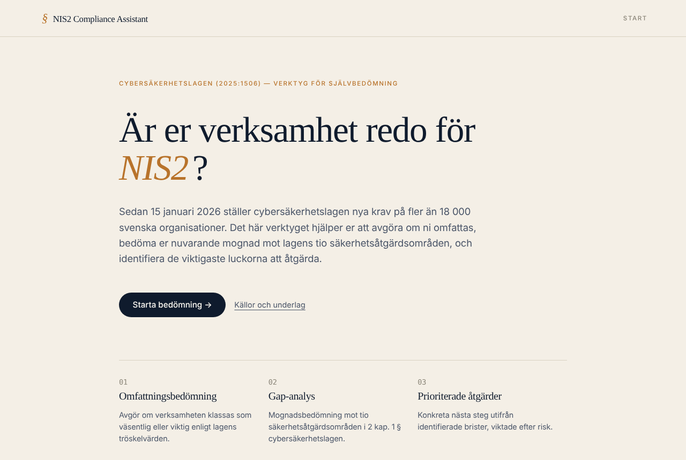
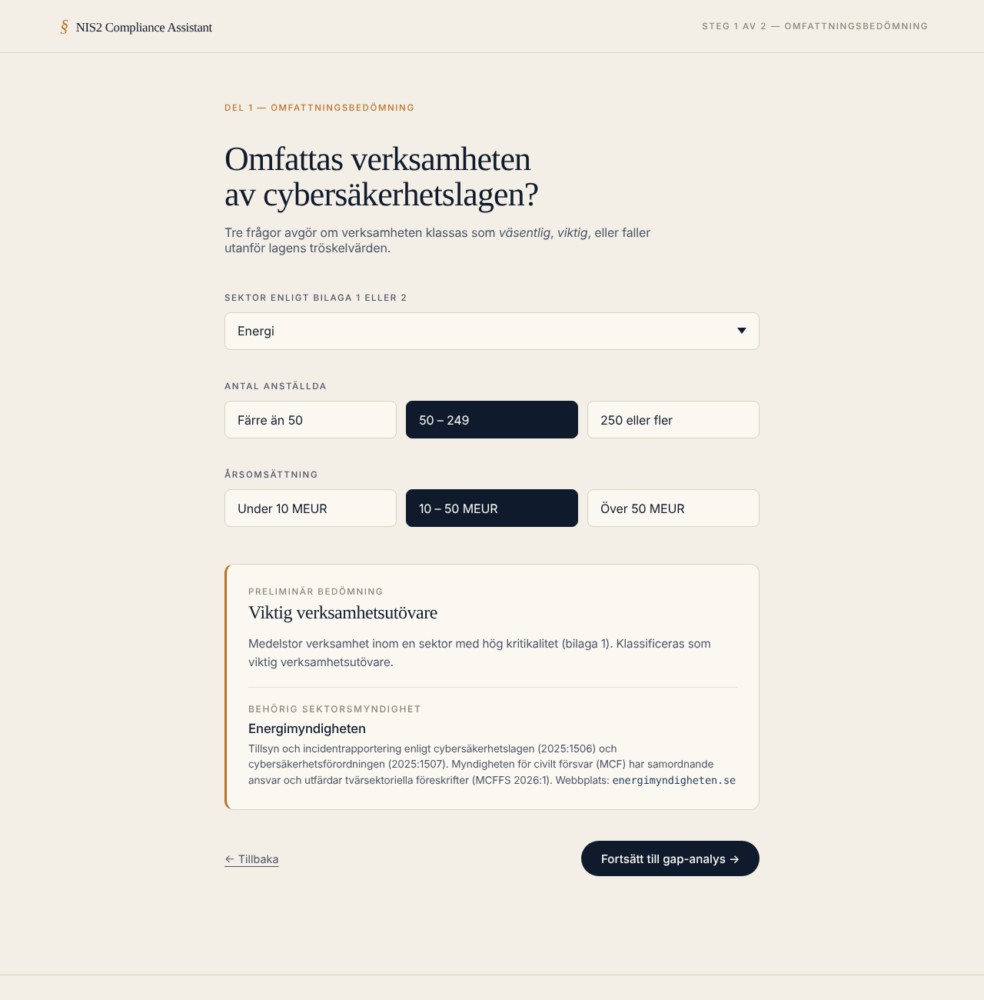
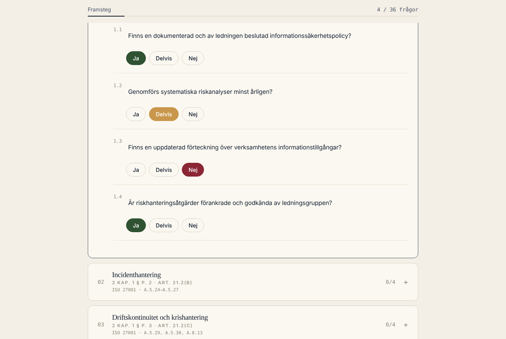
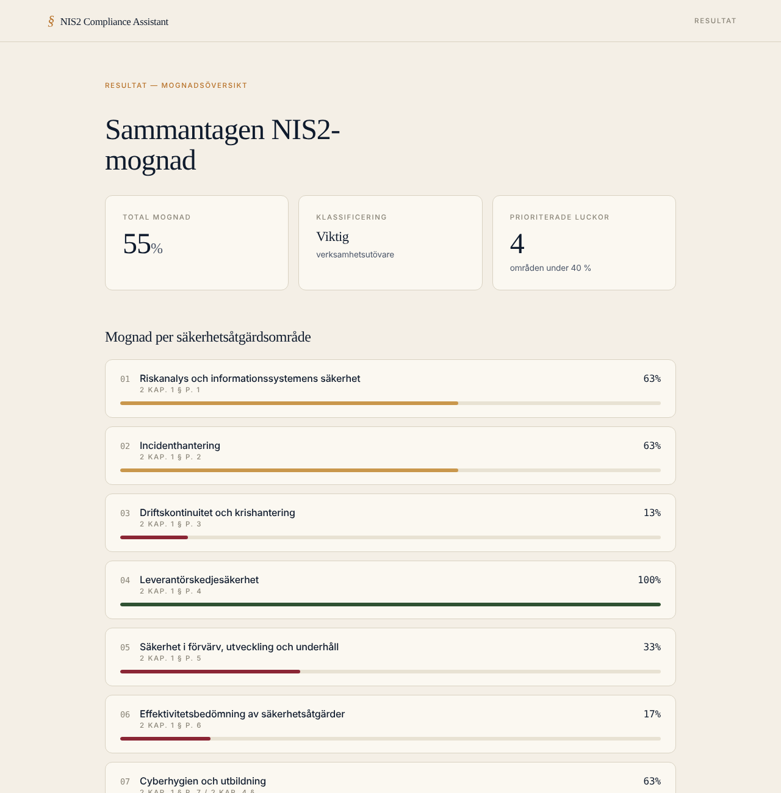

# NIS2 Compliance Assistant

> A self-assessment tool that helps Swedish SMEs comply with the Swedish Cybersecurity Act (2025:1506), which implements the EU NIS2 directive. Built as my degree project for the .NET developer programme at Teknikhögskolan Gävle.


**Live demo:** _länk kommer_ <!-- Lägg in Vercel-länken här -->



## Varför verktyget finns

Den 15 januari 2026 trädde cybersäkerhetslagen (2025:1506) i kraft. Lagen omfattar nu arton sektorer i stället för sju, och uppskattningsvis 18 000 svenska företag berörs. Många av dem – särskilt medelstora företag i sektorer som omfattas för första gången – saknar vägledning för att översätta lagtexten till konkreta åtgärder.

De NIS2-verktyg som finns på marknaden är internationella, hänvisar inte till svensk lag och fungerar ofta som säljkanaler för konsulttjänster. Det här verktyget är byggt för svenska förhållanden och är fritt från lead-generering.

## Funktioner

1. **Omfattningsbedömning** – avgör utifrån sektor, antal anställda och omsättning om verksamheten är *väsentlig*, *viktig* eller inte omfattas, och visar vilken sektorsmyndighet som utövar tillsyn.
2. **Gap-analys** – 36 frågor fördelade på lagens tio säkerhetsåtgärdsområden (2 kap. 1 §), var och en kopplad till NIS2 art. 21.2 och ISO 27001:2022.
3. **Resultat och roadmap** – mognad per område och en prioriterad åtgärdsplan grupperad efter typ av insats: policy (0–4 veckor), process (1–3 månader) och teknik (3–12 månader).

Svaren sparas automatiskt i webbläsaren (localStorage) så att man kan fortsätta senare. **Ingen data skickas till någon server.**

| Omfattningsbedömning | Gap-analys | Resultat |
|---|---|---|
|  |  |  |

## Teknik

- **React 19** + **TypeScript** (strict) + **Vite**
- **Vitest** för enhetstester av affärslogiken
- **GitHub Actions** kör typkontroll, tester och bygge vid varje push

### Struktur

```
src/
├── data/          # Lagdata: sektorer, säkerhetsåtgärdsområden, incidentfrister
├── lib/           # Ren affärslogik (omfattning, poängsättning, lagring) + tester
├── hooks/         # useSparadBedomning – tillstånd som sparas i localStorage
├── components/    # En komponent per vy: Intro, Wizard, Gap, Resultat
├── styles/        # CSS
└── types.ts       # Gemensamma domäntyper
```

Affärslogiken (`bedomOmfattning`, `beraknaScore`, `prioriteradeLuckor`) är rena funktioner utan beroende till React, vilket gör dem enkla att testa och att flytta till en backend.

## Kom igång

Kräver Node.js 20 eller senare.

```bash
npm install
npm run dev        # startar utvecklingsservern på http://localhost:5173
npm test           # kör enhetstesterna
npm run build      # typkontroll + produktionsbygge
```

## Avgränsningar

Verktyget är en prototyp framtagen som examensarbete. Bedömningen är förenklad (t.ex. omfattas vissa verksamheter oavsett storlek enligt MCFFS 2026:1) och ersätter inte juridisk eller teknisk rådgivning.

## Vidareutveckling

- [ ] Backend i ASP.NET Core med EF Core för att spara och dela bedömningar
- [ ] Export av resultat till PDF
- [ ] Koppling till IEC 62443 för OT-miljöer
- [ ] Användartester med riktiga organisationer

## Källor

Cybersäkerhetslagen (2025:1506), cybersäkerhetsförordningen (2025:1507), prop. 2025/26:28, MCFFS 2026:1 och NIS2-direktivet (EU 2022/2555). Fullständig källförteckning finns i examensarbetet.

## Författare

**Alexander Andersson** – .NET-utvecklare, Gävle
[LinkedIn](https://www.linkedin.com/in/alexander-andersson-dev) · [GitHub](https://github.com/CodeAndersson)
