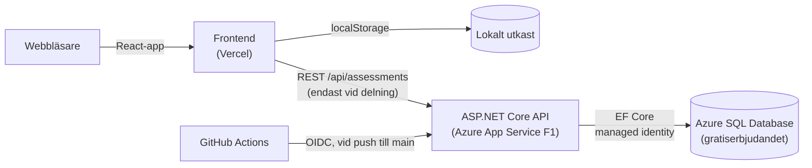

# NIS2 Compliance Assistant

> A self-assessment tool that helps Swedish SMEs comply with the Swedish Cybersecurity Act (2025:1506), which implements the EU NIS2 directive. Built as my degree project for the .NET developer programme at Teknikhögskolan Gävle.


**Live demo:** [nis-2-compliance-assistant.vercel.app](https://nis-2-compliance-assistant.vercel.app/)


## Varför verktyget finns

Den 15 januari 2026 trädde cybersäkerhetslagen (2025:1506) i kraft. Lagen omfattar nu arton sektorer i stället för sju, och uppskattningsvis 18 000 svenska företag berörs. Många av dem – särskilt medelstora företag i sektorer som omfattas för första gången – saknar vägledning för att översätta lagtexten till konkreta åtgärder.

De NIS2-verktyg som finns på marknaden är internationella, hänvisar inte till svensk lag och fungerar ofta som säljkanaler för konsulttjänster. Det här verktyget är byggt för svenska förhållanden och är fritt från lead-generering.

## Funktioner

1. **Omfattningsbedömning** – avgör utifrån sektor, antal anställda och omsättning om verksamheten är *väsentlig*, *viktig* eller inte omfattas, och visar vilken sektorsmyndighet som utövar tillsyn.
2. **Gap-analys** – 36 frågor fördelade på lagens tio säkerhetsåtgärdsområden (2 kap. 1 §), var och en kopplad till NIS2 art. 21.2 och ISO 27001:2022.
3. **Resultat och roadmap** – mognad per område och en prioriterad åtgärdsplan grupperad efter typ av insats: policy (0–4 veckor), process (1–3 månader) och teknik (3–12 månader).

4. **Spara och dela** *(valfritt)* – med backend igång kan bedömningen sparas på servern och delas via en länk, t.ex. med ledningsgruppen. Den kan tas bort från servern igen med ett klick.

**Lokalt först.** En gap-analys är i praktiken en karta över verksamhetens säkerhetsluckor, så svaren sparas som standard bara i webbläsaren (localStorage). Inget skickas till servern förrän användaren själv väljer att dela.

| Omfattningsbedömning | Gap-analys | Resultat | Dela |
|---|---|---|---|
|  |  |  |  |

## Teknik

| Del | Teknik |
|---|---|
| Frontend | React 19, TypeScript (strict), Vite |
| Backend | ASP.NET Core 10 (Web API), Entity Framework Core 10, Azure SQL i produktion, SQLite lokalt |
| Tester | Vitest (frontend), xUnit + WebApplicationFactory (backend) |
| CI/CD | GitHub Actions – typkontroll, tester och bygge av frontend och backend, driftsättning av API:t till Azure |
| Drift | Vercel (frontend), Azure App Service + Azure SQL Database (API) |



Lokalt och i testerna används SQLite i stället för Azure SQL – vilken databas som används styrs av `Database:Provider`.

### Struktur

```
server/
├── src/Nis2.Api/
│   ├── Controllers/   # AssessmentsController – REST-endpoints
│   ├── Services/      # AssessmentService – affärslogik och databasåtkomst
│   ├── Domain/        # Entiteter, sektorer och ScopeAssessor (omfattningsbedömning)
│   ├── Contracts/     # Request/response-DTO:er och validering
│   └── Data/          # AppDbContext, en subklass per databas och deras EF Core-migreringar
└── tests/Nis2.Api.Tests/   # Enhetstester och integrationstester mot hela API:t
src/
├── data/          # Lagdata: sektorer, säkerhetsåtgärdsområden, incidentfrister
├── lib/           # Ren affärslogik (omfattning, poängsättning, lagring) + tester
├── hooks/         # useSparadBedomning – tillstånd som sparas i localStorage
├── components/    # En komponent per vy: Intro, Wizard, Gap, Resultat
├── styles/        # CSS
└── types.ts       # Gemensamma domäntyper
```

Affärslogiken (`bedomOmfattning`, `beraknaScore`, `prioriteradeLuckor`) är rena funktioner utan beroende till React, vilket gör dem enkla att testa. Omfattningsbedömningen finns även i backend (`ScopeAssessor`), så att klassificeringen av en sparad bedömning alltid räknas fram på servern i stället för att lita på data från klienten.

### API

| Metod | Endpoint | Beskrivning |
|---|---|---|
| `POST` | `/api/assessments` | Skapar en bedömning → `201 Created` |
| `GET` | `/api/assessments/{id}` | Hämtar en bedömning inklusive serverns omfattningsbedömning |
| `PUT` | `/api/assessments/{id}` | Ersätter uppgifter och svar |
| `DELETE` | `/api/assessments/{id}` | Tar bort en bedömning → `204 No Content` |
| `GET` | `/health` | Hälsokontroll – svarar utan att röra databasen |
| `GET` | `/health/ready` | Hälsokontroll inklusive databasanslutning |

Ogiltiga requests ger `400` med valideringsfel enligt RFC 7807. API:t är publikt, så `/api/assessments` begränsas till 30 anrop per minut och klient-IP (`429 Too Many Requests`), och request-bodies över 16 kB avvisas (`413`). Swagger UI finns på `/swagger` i utvecklingsläge, och `Nis2.Api.http` innehåller färdiga anrop för Visual Studio/VS Code.

## Kom igång

### Endast frontend

Kräver Node.js 20 eller senare. Appen fungerar fullt ut utan backend.

```bash
npm install
npm run dev        # http://localhost:5173
npm test           # Vitest
npm run build      # typkontroll + produktionsbygge
```

### Med backend (spara och dela)

Kräver .NET 10 SDK.

```bash
cd server
dotnet run --project src/Nis2.Api   # http://localhost:5080, Swagger på /swagger
dotnet test                         # xUnit
```

Databasen (SQLite) skapas och migreras automatiskt vid start. Peka sedan frontend mot API:t:

```bash
cp .env.example .env.local          # innehåller VITE_API_URL=http://localhost:5080
npm run dev
```

## Driftsättning

API:t körs på **Azure App Service** och data lagras i **Azure SQL Database**. Allt ligger i resursgruppen `rg-nis2-demo` (Sweden Central) och är valt för att kosta 0 kr:

| Resurs | Nivå | Varför den är gratis |
|---|---|---|
| App Service (Linux, .NET 10) | F1 Free | 60 CPU-minuter per dag. Appen somnar när den inte används, så första anropet efter en stund tar några sekunder. |
| Azure SQL Database (serverless) | Gratiserbjudandet | 100 000 vCore-sekunder och 32 GB per månad. Databasen pausar efter en timmes inaktivitet, och om gratiskvoten tar slut pausas den resten av månaden i stället för att debitera. |
| Budget | 50 kr/månad | E-postvarning vid 50 % och 100 % av budgeten, och när prognosen pekar mot att den överskrids. |

**Pipeline.** Jobbet `deploy-api` i [`ci.yml`](.github/workflows/ci.yml) körs vid push till `main` som rör `server/`, och först när backend-testerna gått igenom. Det publicerar API:t, driftsätter till App Service och avslutar med ett röktest mot `/health/ready`.

**Inga lösenord någonstans.**
- *GitHub → Azure:* inloggningen sker med OIDC. GitHub utfärdar en kortlivad token som Azure litar på via en federerad identitet, som bara godtar jobb i miljön `production` i det här repot. Identiteten har rollen *Website Contributor* på enbart webbappen.
- *API → databas:* webbappen har en systemtilldelad managed identity och loggar in i Azure SQL med Microsoft Entra ID (`Authentication=Active Directory Managed Identity`). SQL-servern tillåter bara Entra-inloggning, så det finns inget SQL-lösenord. Databasanvändaren har bara rollerna `db_datareader`, `db_datawriter` och `db_ddladmin` (den sista behövs för att migreringarna ska kunna köras vid start).

**Konfiguration** ligger som app settings i App Service, inte i repot: `Database__Provider=SqlServer`, `ConnectionStrings__Default` (utan hemligheter), `Cors__AllowedOrigins__0` (Vercel-adressen) och `ASPNETCORE_FORWARDEDHEADERS_ENABLED=true`, så att rate limitingen ser klientens riktiga IP bakom App Services proxy. App Service använder `/health` som hälsokontroll; den rör medvetet inte databasen, eftersom en kontroll varje minut annars skulle hålla serverless-databasen vaken dygnet runt och förbruka gratiskvoten.

**Migreringar.** EF Core-migreringar är knutna till en databasprovider, så det finns en uppsättning per provider (`Data/Migrations/Sqlite` och `Data/Migrations/SqlServer`). Efter en modelländring skapas båda:

```bash
cd server
dotnet tool restore
dotnet ef migrations add <Namn> --project src/Nis2.Api --context SqliteAppDbContext --output-dir Data/Migrations/Sqlite
dotnet ef migrations add <Namn> --project src/Nis2.Api --context SqlServerAppDbContext --output-dir Data/Migrations/SqlServer
```

## Avgränsningar

Verktyget är en prototyp framtagen som examensarbete. Bedömningen är förenklad (t.ex. omfattas vissa verksamheter oavsett storlek enligt MCFFS 2026:1) och ersätter inte juridisk eller teknisk rådgivning.

Delning bygger på svårgissade länkar (GUID) och har ingen inloggning – den som har länken kan läsa och uppdatera bedömningen. För verklig produktion behövs autentisering.

## Vidareutveckling

- [x] Backend i ASP.NET Core med EF Core för att spara och dela bedömningar
- [ ] Inloggning och behörighetsstyrning för delade bedömningar
- [x] Driftsättning av API:t i Azure (App Service + Azure SQL)
- [ ] Export av resultat till PDF
- [ ] Koppling till IEC 62443 för OT-miljöer
- [ ] Användartester med riktiga organisationer

## Källor

Cybersäkerhetslagen (2025:1506), cybersäkerhetsförordningen (2025:1507), prop. 2025/26:28, MCFFS 2026:1 och NIS2-direktivet (EU 2022/2555). Fullständig källförteckning finns i examensarbetet.

## Författare

**Alexander Andersson** – .NET-utvecklare, Gävle
[LinkedIn](https://www.linkedin.com/in/alexander-andersson-dev) · [GitHub](https://github.com/CodeAndersson)
